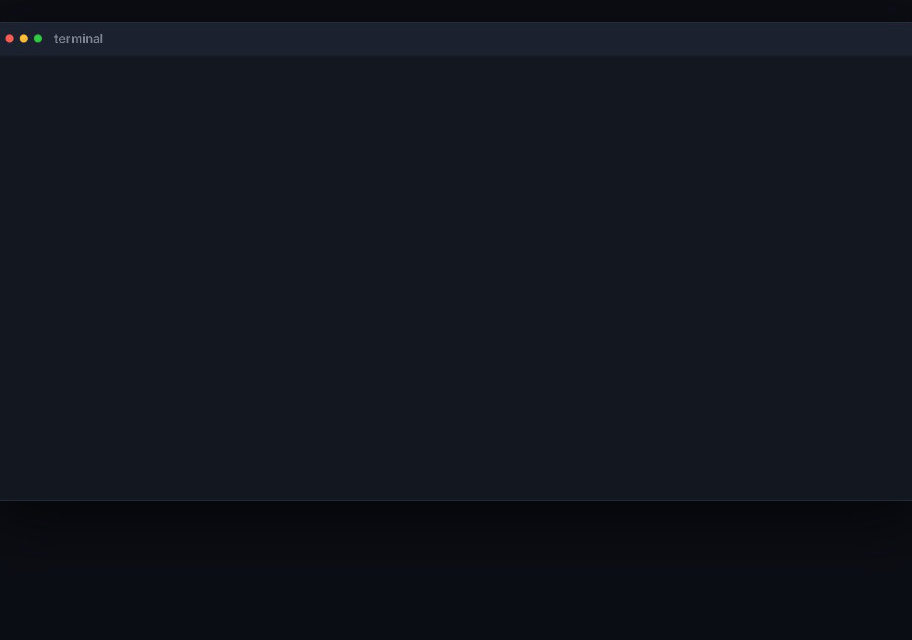

<div align="center">


# DriftCatch

**Learns what your AI agent always does — then tells you the moment it stops.**

[](https://pypi.org/project/driftcatch/)
[](https://github.com/NEEL7127/driftcatch/actions/workflows/ci.yml)




</div>

> **0.1 pre-release.** The engine, CLI, pytest plugin, local UI and MCP server
> are implemented and tested against the real OpenAI and Anthropic SDKs — 407
> tests, `mypy --strict` clean. Not yet on PyPI, and not yet used by anyone but
> its author. If you try it and something is wrong, an issue is more useful to
> me than a star.

---

## The problem

You tweak one word in a prompt. Your agent quietly stops querying the database and
starts web-searching. The answer still *looks* right, so every eval passes. You find
out from a customer.

Or worse — the trajectory is identical, every tool fires in the right order, and the
refund amount is wrong by a factor of a hundred.

**Agents don't fail loudly. They drift.**

## 30 seconds

```python
import driftcatch as drift

@drift.tool
def lookup_order(order_id: int) -> dict: ...

def test_refund():
    with drift.take("refund_1182") as take:      # records once, replays forever
        result = refund_agent("refund order 1182")

    take.assert_tools().called("lookup_order").never("web_search")
    take.assert_invariants().hold()              # rules you never wrote
```

```powershell
pytest            # run 1: records a PENDING recording
```
```powershell
drift review      # a human approves it -> golden
```
```powershell
pytest            # run 2: replays. zero API calls, milliseconds.
```

---

## The 60-second demo

[`assets/driftcatch-launch.mp4`](assets/driftcatch-launch.mp4) — or render it
yourself from [`demo/`](demo/), where the script and the Remotion source live.

Every command in it exists, and the `drift bisect` output is copied from a real
run against the sandbox in `demo/seed_demo.py`. An earlier cut showed a
composite nobody could reproduce; that seemed like the wrong corner to cut for a
tool about honest failure reporting.

## What makes this different

**Record/replay for agents is not a differentiator.** `vcrpy`, `pytest-agentreplay`,
`agentreplay`, `graphtrace`, `trajence`, `agent-trajectory-diff` and LangChain's own
`agentevals` all record runs and diff tool-call sequences. If that is all you need,
use one of those — several are good.

DriftCatch is built on a different idea:

> **Every other tool treats a recording as a mock. DriftCatch treats a corpus of
> approved recordings as a specification you never had to write.**

### 1. It learns your agent's rules ⭐

Six approved recordings. Nobody wrote a single assertion:

```
$ drift learn

  Mined 15 invariant(s) from 6 approved recording(s):

  ALWAYS lookup_order always runs before issue_refund                6/6 runs  conf 0.98
  ALWAYS notify_customer is always the last tool                     6/6 runs  conf 0.98
  ALWAYS issue_refund.args.amount always equals lookup_order.result.total  6/6  conf 0.98
  BOUND  a run never makes more than 3 tool calls                    6/6 runs  conf 0.98
  NEVER  web_search is offered but never called                      6/6 runs  conf 0.98

  15 not yet enforced. Mined rules are evidence, not truth -
  review them, then: drift learn --approve
```

That third rule is a **business rule your agent follows that nobody ever wrote down**.
Then a new run arrives:

```
trajectory:  lookup_order -> issue_refund -> notify_customer     ← looks perfect
```

```
x issue_refund.args.amount always equals lookup_order.result.total
    5000 != 50
    (held in 6/6 previous runs)
```

A decimal slipped. **Every trajectory-diffing tool passes this run.** Caught by a rule
nobody wrote, in a scenario nobody tested, for free.

This is specification mining — 25 years proven in conventional software (Daikon,
Perracotta), never before pointed at agent trajectories. It needs a corpus of runs you
*know* are correct, which is why the human approval gate is load-bearing rather than
ceremony.

**Four filters stop it generating confident nonsense:**

| Filter | Why |
|---|---|
| support ≥ 5 | two observations is a coincidence |
| confidence ≥ 0.95 (`1 − 0.5ⁿ`) | Daikon's statistical gate |
| **the value must vary across runs** | two fields both `40` every time is a constant, not a relationship |
| redundancy removal | transitive ordering and equality collapsed, so 19 rules become 15 distinct facts |

Daikon's own evaluation found ~⅓ of mined invariants were wrong or irrelevant — which
is exactly why nothing is enforced until you approve it.

### 2. Behaviour coverage

```
$ drift coverage

  BEHAVIOUR COVERAGE    25.0%  #####...............

  TOOL                      CALLED  CALLS   ERROR PATH
  escalate_to_human             NO      0           NO
  issue_refund                 yes      1           NO
  web_search                    NO      0           NO
```

Code coverage tells you which *lines* ran. This tells you which *behaviours* were ever
tested — and the denominator comes free from the tool schemas in your own recorded
request. Each tool counts twice: success path and failure path.

`--fail-under 80` gates CI (exit code `4`). `--badge` prints the badge.

### 3. Root-cause attribution

Other tools say *"it differs."* DriftCatch says **why**:

```
$ drift bisect refund_1182 --previous

  ROOT CAUSE: the system prompt.
    - Use available tools to find
    + Search for
```

Certain when exactly one input moved; it declines to guess when several did.

### 4. Drift detection

Four inputs — system prompt, model id, tool schemas, matcher config — hashed
**separately**, so a change names itself:

```
⚠ recording "refund_1182" is STALE: prompt_hash changed since it was approved
```

Detected **offline during a normal replay run**, before anything is sent. Comparing
inputs never requires the model.

### 5. What-if, without re-recording

```python
with drift.take("refund_1182").what_if(tool="send_reply", raises="TimeoutError") as take:
    refund_agent("refund order 1182")
take.assert_tools().call_count("send_reply", 2)      # the retry finally runs
```

Coverage finds the gap; what-if fills it. The file on disk is never modified.

### 6. Determinism scoring

```python
result = drift.run_live("refund_1182", lambda: agent("..."), runs=20)
result.assert_matches_golden(pass_k=(17, 20))
```
```
20 live runs · 3 distinct trajectories · DETERMINISM 0.85
recommended gate: pass_k=(17, 20)
```

---

## Assertions

```python
take.assert_tools().called_in_order("lookup_order", "issue_refund")
take.assert_trajectory().matches_golden(tolerance="exact")
take.assert_output().is_json().json_has("decision", "amount")
take.assert_output().excludes("internal_customer_id")
take.assert_cost().under(tokens=2_000)
take.assert_latency().under(total_ms=5_000)
take.assert_invariants().hold()
```

Latency assertions **skip during replay**, with a warning, rather than
comparing a recorded duration against itself and passing forever. Replay reads
bytes from disk; there is no call to time. See
[assertions](docs/assertions.md#latency--assert_latency).

## Scenario suites

One body, many cases, one shared policy — so the fortieth scenario gets the
assertion somebody added to the third.

```python
refunds = drift.Suite(
    "refund",
    cases={"small": "refund order 1182", "large": "refund order 9999"},
    check=lambda take: take.assert_invariants().hold(),
)

@refunds.parametrize
def test_refund(take, case):
    run_agent(case)
```

Each case gets its own recording, so a diff still points at one scenario.

## Built for coding agents

Cursor, Claude Code and Codex are first-class users, not an afterthought.

**`drift init` writes an `AGENTS.md`** your agent reads automatically — including the
rules it would otherwise get wrong (*"do not re-record to make a failing test pass"*).

**Every read command takes `--json`** with a stable `{ok, command, ...}` envelope,
clean stdout, no ANSI, and errors as JSON with a `hint` field.

**Documented exit codes**, so an agent branches before parsing:

```
0 ok · 1 error · 2 usage · 3 regression · 4 gate_failed
5 secrets_found · 6 not_found · 7 not_approved
```

**`drift explain --json`** is a self-describing manifest — one call and the agent knows
the commands, workflows, cautions and what this tool is *not* for.

**An MCP server** (`drift mcp`) exposing 10 tools. See [docs/MCP.md](docs/MCP.md).

> **What the agent deliberately cannot do:** `approve`, `reject`, `record`, `restore`
> and live runs are not exposed. An agent's reflex on a red test is to make it green —
> and in DriftCatch the green button is *approve*, which means "a human confirmed this
> behaviour is correct". `pending_approvals` lets the agent surface the decision
> without making it.

---

## Honest limits

**Two tiers, and we are explicit about which catches what:**

| Tier | Cost | Catches | Cannot catch |
|---|---|---|---|
| **1 — replay** (every commit) | $0, ms | changes to *your* prompt, model id, tool schemas, code; broken learned invariants | what the model would decide **today** — it isn't running |
| **2 — live check** (deliberate) | real spend | model-behaviour change, provider-side change | nothing deterministically; thresholded with `pass_k` |

Any tool claiming replay alone catches model-behaviour change is wrong about the physics.

Also stated plainly:

- **Not a production cache.** It errors on any request it hasn't recorded. Using it to
  serve users would be dangerous.
- **Not an evaluation tool.** It never scores answer quality. Answer text may change
  freely; behaviour must not.
- **No universal tool capture.** `@drift.tool` is one line per tool; there is no generic hook.
- **Invariant mining needs a corpus** — at least 5 approved recordings before it says anything.
- **Mined rules are *likely* invariants, not proofs.** Review them.

---

## Security

Redaction runs **at record time, before anything touches disk**, and **fails closed** —
if a credential-shaped value survives, the recording is **not written at all**. Headers
are never recorded. `drift scan` audits existing recordings (exit `5` on findings) for a
pre-commit hook. The UI binds loopback only and refuses anything else.

---

## Install

```powershell
pip install driftcatch                 # not yet published
pip install "driftcatch[ui]"           # local web UI
pip install "driftcatch[mcp]"          # MCP server for coding agents
```

## CLI — 24 commands

```
drift init                          # set up, write AGENTS.md, print a starter test
drift explain [--json]              # self-describing manifest for agents
drift status [--json]               # recordings: status, behaviour, drift
drift status --require-approved     # exit 7 if anything is still pending (CI)
drift show <name>                   # one recording in full
drift review [name] [--yes]         # walk the pending queue  (the human gate)
drift approve <name> --by you       # approve one, non-interactively
drift reject <name>                 # mark one wrong, so it never becomes golden
drift learn [--approve] [--json]    # mine the rules your agent follows
drift invariants [--json]           # learned rules and whether enforced
drift contracts [--json]            # declared tool schemas vs how they are used
drift coverage [--fail-under N]     # behaviour coverage (+ --badge, --json)
drift suggest                       # scenarios for uncovered paths
drift diff <name> --against <other> # behaviour diff
drift bisect <name>                 # attribute a behaviour change
drift bisect <name> --previous      # ...against the version a re-record replaced
drift restore <name>                # undo a re-record
drift what-if <name> --fail-tool X
drift audit <name>                  # how each request keys
drift scan [--json]                 # secret / PII audit
drift prune                         # drop raw bodies, keep behaviour
drift record / drift check [--live] # run your tests in the right mode
drift ui                            # local web UI
drift mcp                           # MCP server for coding agents
```

Documented exit codes, so CI and agents can branch without parsing output:
`0` ok · `1` error · `2` usage · `3` behaviour regression · `4` gate failed ·
`5` secrets found · `6` not found · `7` not approved.

## pytest

```
pytest --drift-mode=replay        # auto | record | replay | live
pytest --drift-update             # re-record (returns to pending; old version archived)
pytest --drift-policy=fail        # treat stale recordings as failures
```

## Extending

Three match strategies (`field`, `positional`, `tool_call`) plus a `chain(...)`
combinator, five normalizers, and a registry where your own are first-class:

```python
@drift.matcher("match_on_question_only")
def _(request, candidates, state, ctx): ...
```

## Development

```powershell
python -m venv .venv
.venv\Scripts\python.exe -m pip install -e ".[dev]"
.venv\Scripts\python.exe -m pytest -n 4
.venv\Scripts\python.exe -m ruff check driftcatch tests examples scripts
.venv\Scripts\python.exe -m mypy driftcatch
```

Try the demos:

```powershell
.venv\Scripts\python.exe scripts\demo_invariants.py
```
```powershell
.venv\Scripts\python.exe -m pytest examples/refund_agent -q
```

## Documentation

Full docs: **[`docs/index.md`](docs/index.md)**

| | |
|---|---|
| [Getting started](docs/getting-started.md) | Install to caught regression, five minutes |
| [Core concepts](docs/concepts.md) | Two tiers, the approval gate, fingerprints |
| [Recording and replay](docs/recording-and-replay.md) | Modes, capture, streaming, pruning |
| [Assertions](docs/assertions.md) | Tools, trajectory, output, cost, latency |
| [Scenario suites](docs/suites.md) | One body, many cases, one policy |
| [Matching](docs/matching.md) | Matchers, normalizers, chaining |
| [Learned invariants](docs/invariants.md) | Rules mined from the corpus |
| [Tool contracts](docs/contracts.md) | Declared schema vs real use |
| [CLI reference](docs/cli.md) | Every command and exit code |
| [CI integration](docs/ci.md) | Pipelines, JUnit, what to gate on |
| [Coding agents and MCP](docs/MCP.md) | Cursor, Claude Code, the MCP server |
| [Configuration](docs/configuration.md) | Every setting and its default |
| [Security](docs/security.md) | Secrets, redaction, the MCP boundary |
| [Troubleshooting](docs/troubleshooting.md) | Specific errors and fixes |
| [FAQ](docs/faq.md) | Including what this deliberately does not do |

Design background:

- [`DESIGN.md`](DESIGN.md) — architecture and rationale
- [`IMPLEMENTATION_PLAN.md`](IMPLEMENTATION_PLAN.md) — build order and design-change log
- [`CRITIQUE.md`](CRITIQUE.md) — the review that shaped this version
- [`CONTRIBUTING.md`](CONTRIBUTING.md) — setup, quality bar, deliberate design positions
- [`CHANGELOG.md`](CHANGELOG.md)

## License

MIT. See [LICENSE](LICENSE).
